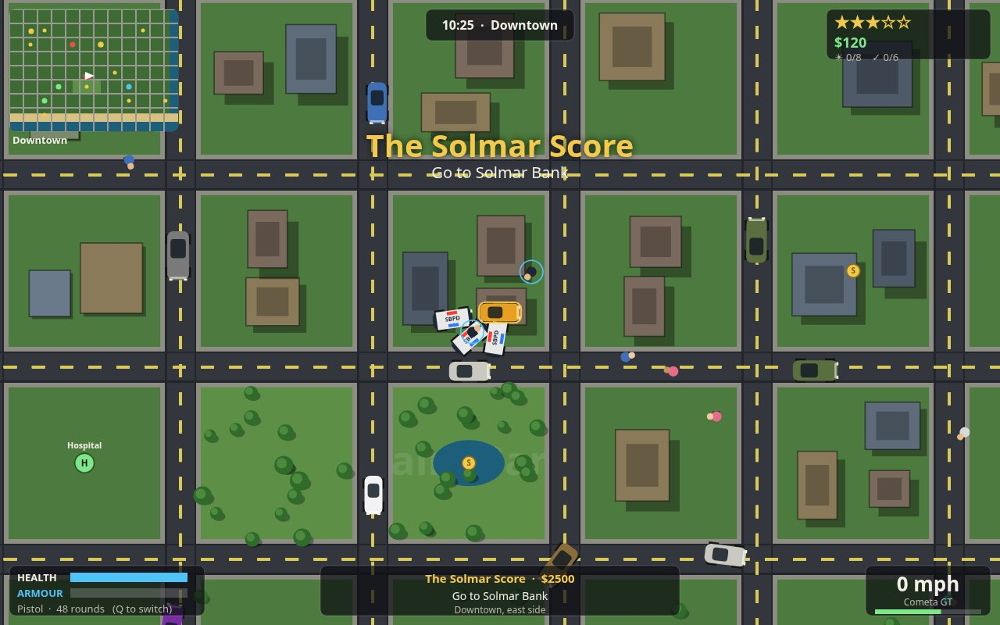
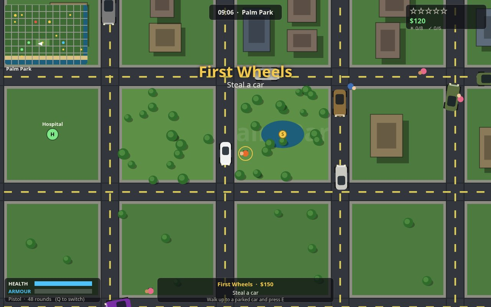
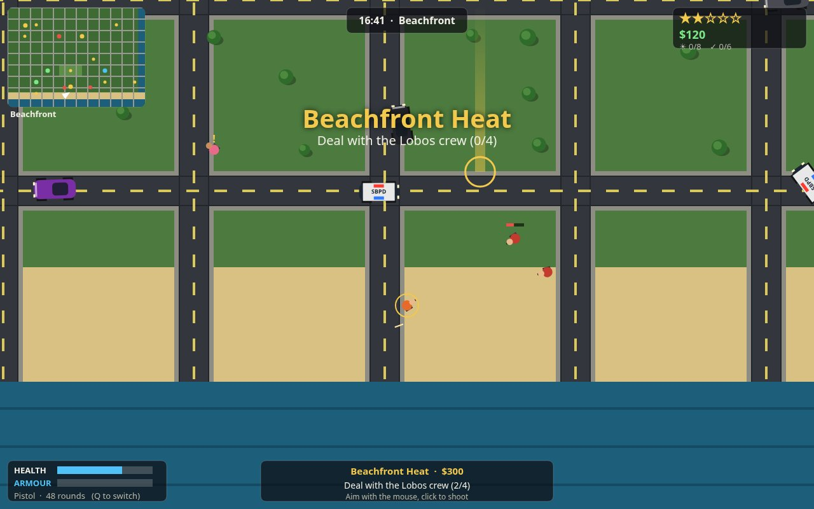
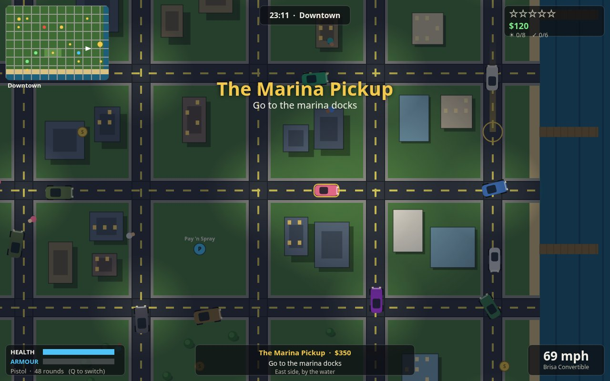

# Solmar Bay — an original open-world crime game

[](https://make.fun/c/gta6-01)
[](https://make.fun/c/gta6-01)
[](https://make.fun/c/gta6-01)

Solmar Bay is an original open-world crime game built for the
[make.fun GTA 6 bounty](https://make.fun/bounty/gta6-01). Rico Vega is back in
Solmar Bay, and his fixer Tia Carmen has work for him across the city — from
stealing his first wheels to the big one, The Solmar Score. Everything here is
original: the names, characters, places, story, art and music are all made for
this game. It runs in a desktop browser from plain static files, with no
network and no libraries.

## How to play

Serve `game/` with any static server and open `game/index.html` in desktop
Chrome. For example:

```sh
cd game
python3 -m http.server 8080
```

Then open http://localhost:8080 in Chrome. Press Enter on the title screen to
start. Your progress autosaves, so a save on the title screen lets you pick up
where you left off.

## Features

- A seeded open world: a 3600×2600 city with Downtown, Old Town, Marina,
  Beachfront, Industrial, Suburbs and Palm Park, explored on foot and by car
- Six stealable cars — Vela Sedan, Cometa GT, Rancho Pickup, Brisa
  Convertible, Carguero Van and Bajito Lowrider — plus road-graph traffic and
  pedestrians
- A wanted system from 0 to 5 stars, with SBPD police cars and foot officers,
  chases, rams and arrests
- Combat on foot: fists and a pistol, with mouse aim
- Six story missions for Tia Carmen, ending in the bank job, The Solmar Score
- 8 hidden Sun Coins worth $250 each
- City services: Carmen's Garage, Ammo-Nation Gun Shop, Pay 'n Spray and
  Solmar General Hospital
- A full HUD: minimap, wanted stars, cash, health and armour, weapon and
  ammo, mission tracker, clock and speedometer
- A day/night cycle with headlights, street lights and lit windows
- Fully synthesized sound: engine, sirens, gunfire, pickups and an original
  chiptune station, Radio Solmar
- Saves in localStorage, with title, pause, wasted, busted and win screens

## Controls

| Key | Action |
| --- | --- |
| WASD / arrow keys | Move on foot, drive |
| Mouse | Aim on foot |
| Click | Shoot / punch |
| E | Enter or exit a car, interact |
| Q | Switch fists / pistol |
| R | Toggle the radio |
| P or Esc | Pause |
| Enter | Start / continue |

## Screenshots

The four screenshots below are real renders of this game, staged with
`?shot=cover|street|beach|night&seed=1`:






## Build note

`main.ts` (Node 22, standard library only) copies `game/` and `screenshots/`
to the output directory and writes `dossier.json` there using the vendored
make.fun library. Outside the grader, `MAKEFUN_OUTPUT_DIR` stands in for
`/output`:

```sh
MAKEFUN_OUTPUT_DIR=out node main.ts
```

Running it twice over the same tree gives byte-identical outputs.

## License

MIT — see [LICENSE](LICENSE).
